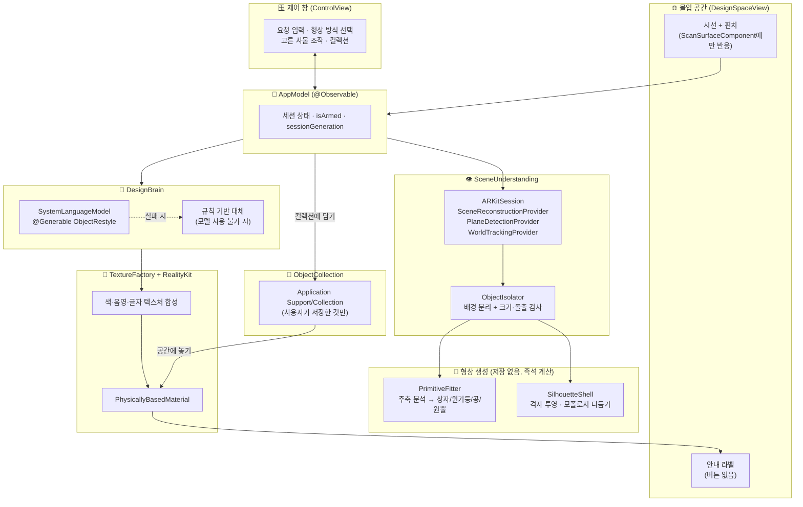
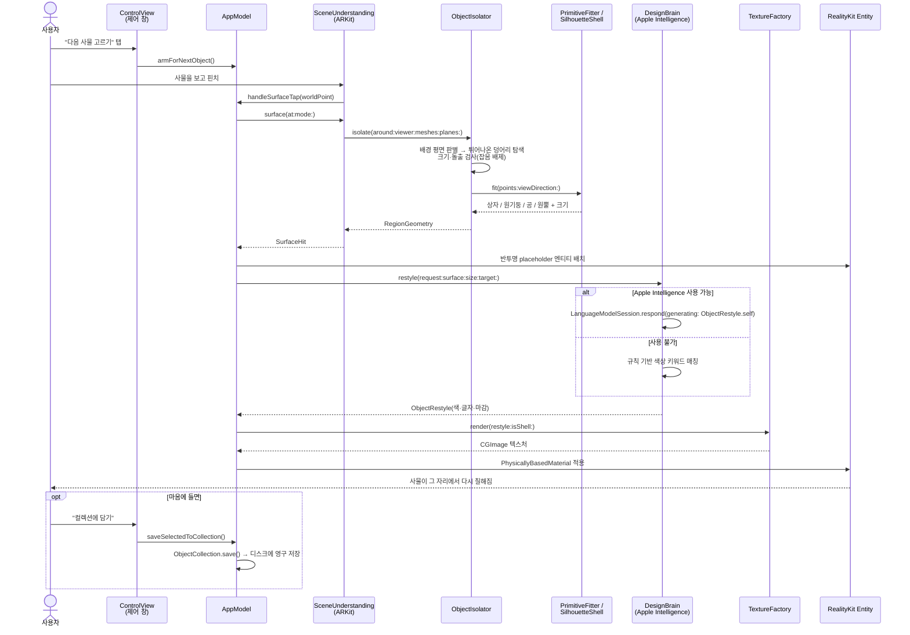
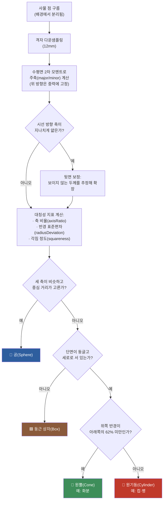
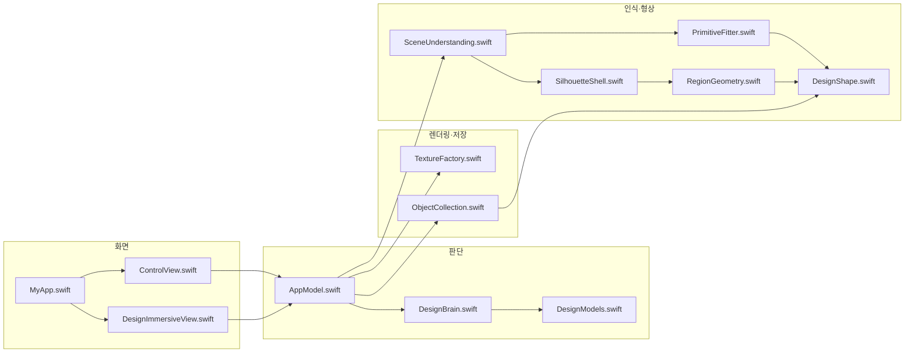

# 사물 리디자인 (Object Restyle for Apple Vision Pro)

**바라본 사물을 그 자리에서, 그 모양 그대로 다시 색칠하는 visionOS 앱.**
온디바이스 Apple Intelligence와 ARKit 라이다 재구성만으로 동작하며, 서버 호출이나 이미지 검색·저장이 전혀 없습니다.

> 이 저장소는 개인 프로젝트로 만들어졌으며, 실제 Apple Vision Pro 실기기에서 개발·검증되었습니다. 시뮬레이터는 라이다 데이터를 제공하지 않아 지원하지 않습니다.

---

## 목차

- [무엇을 하는 앱인가](#무엇을-하는-앱인가)
- [스크린샷](#스크린샷)
- [핵심 아이디어](#핵심-아이디어)
- [아키텍처](#아키텍처)
- [동작 파이프라인](#동작-파이프라인)
- [형상 판정 로직](#형상-판정-로직)
- [모듈 구성](#모듈-구성)
- [온디바이스 AI 사용 방식](#온디바이스-ai-사용-방식)
- [프라이버시: 저장하는 것과 저장하지 않는 것](#프라이버시-저장하는-것과-저장하지-않는-것)
- [요구 사항](#요구-사항)
- [빌드 및 실행](#빌드-및-실행)
- [사용 방법](#사용-방법)
- [알려진 한계](#알려진-한계)
- [라이선스](#라이선스)

---

## 무엇을 하는 앱인가

Vision Pro를 쓰고 방 안의 사물—컵, 화분, 책, 모니터, 창문, 문—을 바라본 뒤 손가락을 맞대면(핀치),
앱이 다음을 그 즉시 처리합니다.

1. 라이다로 그 사물을 배경(벽·바닥)에서 떼어낸다.
2. 사물 모양에 맞는 입체(상자·원기둥·공·원뿔)를 골라 씌운다.
3. 온디바이스 언어 모델이 사용자의 요청("네이비색으로 바꿔줘", "무광 검정에 'MW' 글자")에 맞는 색과 짧은 글자를 정한다.
4. 그 색과 글자를 텍스처로 구워 사물 위에 그 자리에서 입힌다.

마음에 든 결과는 **컬렉션**에 사물 모양 그대로 저장해 두고, 나중에 아무 곳에나 다시 꺼내 놓아 손으로 옮기고 돌릴 수 있습니다.

이 앱은 사물의 형태를 바꾸거나 새로운 그림·패턴·로고를 그리지 않습니다. **오직 색과 짧은 글자만** 바꿔, 사물이 본래 무엇인지 항상 알아볼 수 있게 합니다.

## 스크린샷

> 아래는 대표 화면의 자리 표시자입니다. 실기기에서 캡처한 이미지를 이 경로에 덮어써 주세요.
> (Vision Pro에서 `Digital Crown + 상단 버튼`으로 캡처하거나, Xcode의 Devices 창에서 화면을 가져올 수 있습니다.)

| 제어 창 | 사물 리디자인 결과 | 컬렉션 |
|---|---|---|
|  |  |  |

## 핵심 아이디어

| 원칙 | 구현 |
|---|---|
| **완전 온디바이스** | 색·글자 판단은 `FoundationModels`(`SystemLanguageModel`)만 사용. 네트워크 호출 없음. |
| **아무것도 쌓아두지 않음** | 방·사물의 라이다 데이터는 그 순간 계산에만 쓰이고 즉시 버려짐. 디스크에 남는 건 사용자가 직접 "컬렉션에 담기"를 누른 결과뿐. |
| **사물 고유의 모습 유지** | 패턴·그림·질감을 새로 그리지 않고 색과 짧은 글자만 바꿈. |
| **정확한 형상 매핑** | 라이다 표면을 그대로 따르지 않고, 중력 방향 기준 주축 분석으로 상자/원기둥/공/원뿔에 맞춰 넣음 — Reality Composer Pro로 만든 오브젝트처럼 매끈한 면. |
| **명시적인 조작** | 몰입 공간에는 버튼을 두지 않음(탭 제스처 충돌 방지). 모든 조작은 별도 창(Window)에서. |

## 아키텍처



## 동작 파이프라인

핀치 한 번이 트리거하는 전체 흐름입니다. 모든 단계가 기기 안에서, 실시간으로 끝납니다.



## 형상 판정 로직

`PrimitiveFitter`는 라이다 점 구름의 주축과 대칭성을 분석해 네 가지 프리미티브 중 하나를 고릅니다.
라이다는 사물의 앞면만 보기 때문에, 시선 방향으로 지나치게 얇으면 반대쪽이 있다고 보고 보정합니다.



평면으로 인식된 사물(창문·문·테이블 등)은 이 분석을 거치지 않고, **ARKit이 이미 정리해 준 평면 폴리곤**을 얇은 상자로 만듭니다.
유리창처럼 라이다가 제대로 읽지 못하는 대상에서 이 경로가 훨씬 정확합니다. 실제 표면 그대로를 원한다면 창의 "모양 만드는 방식"에서
**라이다 윤곽(Silhouette)** 모드로 전환할 수 있습니다 — 격자 투영, 모폴로지 열기/닫기, 연결 요소 분석, 경계 스무딩을 거쳐 톱니 없는 껍질을 만듭니다.

## 모듈 구성



| 파일 | 역할 |
|---|---|
| `MyApp.swift` | 앱 진입점. `WindowGroup`(제어 창)과 `ImmersiveSpace`(디자인 공간) 두 씬을 선언. |
| `AppModel.swift` | 전체 상태와 파이프라인을 조율하는 단일 `@Observable` 모델. 세션 세대 번호로 공간을 껐다 켜도 상태가 어긋나지 않게 함. |
| `SceneUnderstanding.swift` | `ARKitSession`으로 씬 재구성·평면 감지·월드 트래킹을 돌리고, `ObjectIsolator`로 탭한 지점의 사물을 배경에서 분리. |
| `PrimitiveFitter.swift` | 점 구름에 상자/원기둥/공/원뿔 중 가장 맞는 형상을 계산. |
| `SilhouetteShell.swift` | (대체 모드) 라이다 삼각형을 사용자 시점 격자에 투영해 닫힌 껍질을 만듦. 모두 즉석 계산, 저장 없음. |
| `RegionGeometry.swift` / `DesignShape.swift` | 형상·배치를 표현하는 값 타입. `Codable`이라 컬렉션에 저장 가능. |
| `DesignBrain.swift` | `FoundationModels`로 색·글자·마감을 판단. 모델이 없으면 키워드 매칭 대체 로직. |
| `DesignModels.swift` | `@Generable ObjectRestyle` 등 모델 출력 스키마와 색상 유틸리티. |
| `TextureFactory.swift` | 색·음영·글자를 `CoreGraphics`/`CoreText`로 텍스처 이미지에 합성. |
| `ObjectCollection.swift` | 사용자가 저장을 선택한 오브젝트만 `Application Support`에 JSON + PNG로 보관. |
| `ControlView.swift` | 제어 창 UI. 인식 시작/끄기, 형상 방식, 요청 입력, 컬렉션, 진행 기록. |
| `DesignImmersiveView.swift` | 몰입 공간 UI. 안내 라벨만 표시(버튼 없음), `ScanSurfaceComponent`가 붙은 엔티티에만 탭 제스처 연결. |

## 온디바이스 AI 사용 방식

`DesignBrain`은 Apple의 **Foundation Models** 프레임워크(`FoundationModels`)로 `SystemLanguageModel.default`를 사용합니다.

```swift
let session = LanguageModelSession(instructions: instructions)
let response = try await session.respond(
    generating: ObjectRestyle.self,          // @Generable 구조체로 응답을 강제
    options: GenerationOptions(temperature: 0.6)
) {
    """
    Object kind: \(surface.englishName)
    The person's request (Korean): "\(request)"
    ...
    """
}
```

- `@Generable`로 표시한 `ObjectRestyle` 구조체(기본색·보조색·글자·글자색·마감)를 스키마로 강제해, 모델이 항상 유효한 색상 값을 반환하도록 함.
- Apple Intelligence가 꺼져 있거나 기기가 지원하지 않으면(`SystemLanguageModel.Availability`), 요청 문구의 한국어/영어 색상 키워드를 매칭하는 규칙 기반 로직으로 자동 전환.
- 이미지 검색·RAG·외부 API 없음 — 판단 근거는 사물 종류, 대략적 크기, 사용자의 한 문장 요청뿐.

## 프라이버시: 저장하는 것과 저장하지 않는 것

| 데이터 | 저장 여부 |
|---|---|
| 방의 라이다 메시·평면 정보 | ❌ 세션 중 메모리에서만 쓰이고 앱 종료·재시작 시 사라짐 |
| 스캔한 사물의 사진 | ❌ 카메라 이미지 자체를 다루지 않음(visionOS가 일반 앱에 카메라 프레임을 주지 않음) |
| 사용자가 "컬렉션에 담기"를 누른 결과 | ✅ `Application Support/Collection/<uuid>.json` + `.png`로 로컬 저장 |
| 네트워크 전송 | ❌ 없음. 모든 계산이 기기 안에서 끝남 |

## 요구 사항

- Xcode 26 이상 (visionOS 27 SDK)
- Apple Vision Pro 실기기 (visionOS 27) — **시뮬레이터는 라이다 데이터가 없어 사물 인식이 동작하지 않습니다**
- Apple Developer 계정 (실기기 배포용 서명)
- Apple Intelligence가 활성화된 기기 권장 (꺼져 있어도 규칙 기반 대체 로직으로 앱 자체는 동작)

## 빌드 및 실행

```bash
git clone https://github.com/<your-username>/<repo-name>.git
open MyRealityApp.xcodeproj
```

1. Xcode에서 Signing & Capabilities의 팀을 본인 계정으로 변경합니다.
2. 상단 실행 대상을 연결된 Vision Pro로 선택합니다.
3. `⌘R`로 빌드·실행합니다.
4. 기기에서 처음 실행하면 **공간 인식(World Sensing)** 권한 팝업이 뜹니다. 허용해야 사물 인식이 동작합니다.

GitHub Desktop을 쓰는 경우 저장소를 클론한 뒤 `MyRealityApp.xcodeproj`를 더블클릭해 Xcode로 열면 됩니다.

## 사용 방법

1. 제어 창에서 원하는 색·글자를 문장으로 적습니다. (예: "무광 검정에 'MW' 글자")
2. **"사물 인식 시작"**을 누릅니다. 몰입 공간이 열리고 방을 스캔합니다.
3. 바꾸고 싶은 사물에 30~50cm까지 다가가 잠시 둘러봅니다(라이다가 그 사물을 읽어야 함).
4. 사물을 보며 손가락을 맞댑니다(핀치). 잠시 후 색이 입혀집니다.
5. 마음에 들면 창의 **"컬렉션에 담기"**를, 다른 색을 보고 싶으면 **"다른 색"**을 누릅니다.
6. 컬렉션에 저장된 오브젝트는 **"공간에 놓기"**로 아무 곳에나 다시 꺼내 손으로 옮기고 돌릴 수 있습니다.

## 알려진 한계

- 유리·거울처럼 라이다가 반사·투과하는 표면은 인식이 불안정합니다. 평면으로 미리 잡힌 창문·문은 ARKit 평면 폴리곤을 우선 사용해 이 문제를 줄였습니다.
- 라이다는 사물의 앞면만 보므로, 뒷면 두께는 추정값입니다.
- 카메라 프레임에 대한 일반 앱 접근 권한이 visionOS에는 없어, 사물의 **원래** 색을 읽어 그 위에 톤을 얹는 방식이 아니라 사물 종류·크기·요청 문구로 새 색을 **판단**하는 방식입니다.
- 매우 작은 사물(5cm 미만)이나 라이다 해상도보다 얇은 사물은 인식되지 않을 수 있습니다.

## 라이선스

이 프로젝트는 [Apache License 2.0](LICENSE)을 따릅니다.
